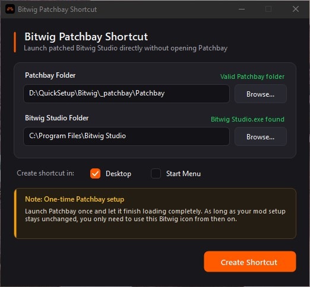

# Bitwig Patchbay Shortcut Launcher

> [!IMPORTANT]
> **Disclaimer:** This tool is an independent, unofficial community project by Mike8040 — it has **nothing to do with Bitwig or Bitwig GmbH** and is **not** affiliated with, endorsed by, or created in cooperation with Bitwig GmbH in any way.

## Why I Built This

Because I prefer to avoid unnecessary friction and want fast, direct access, I built this lightweight tool so that after patching Bitwig Studio once with [Patchbay](https://github.com/shaboogen-dev/Patchbay), you can launch Bitwig directly through the generated shortcut without ever needing to open Patchbay again. You can place the shortcut in the Windows Start Menu, on your Desktop, or move it to any other location you like.

## Download

* **Latest Windows x64 executable:** [`Bitwig-Patchbay-Launcher.exe`](https://github.com/Mike-8040/bitwig-patchbay-shortcut-launcher/releases/download/v1.0.0/Bitwig-Patchbay-Launcher.exe)
* **All Releases:** [Releases page](https://github.com/Mike-8040/bitwig-patchbay-shortcut-launcher/releases)
* **SHA-256 (`Bitwig-Patchbay-Launcher.exe`):** `6f1d49f5e119adfab37bacb41d36c7d0c8e67aee194773014e3795c3449cc18a`

## How to Use

1. Launch **Patchbay** once, set up your mods, and let it finish loading Bitwig Studio completely.
2. Run `Bitwig-Patchbay-Launcher.exe`, verify your **Patchbay Folder** and **Bitwig Studio Folder** (auto-detected), select **Desktop** and/or **Start Menu**, and click **Create Shortcut**.
3. From then on, launch Bitwig Studio directly via the created `Bitwig Studio (Patchbay).lnk` shortcut — you can also move or pin that shortcut to any location you prefer as long as your mod setup remains unchanged.

## Requirements & Notes

* **Platform:** Windows (x64), standalone single-file executable (no separate .NET runtime required).
* **Prerequisites:** Requires an existing [Patchbay](https://github.com/shaboogen-dev/Patchbay) setup with mods configured once beforehand.
* **Windows SmartScreen:** Because the executable is not digitally signed with a commercial code-signing certificate, Windows SmartScreen may show an *"Unknown publisher"* prompt on first launch (click **More info** → **Run anyway**). You can verify the download integrity against the SHA-256 checksum above (`certutil -hashfile Bitwig-Patchbay-Launcher.exe SHA256` or `Get-FileHash`).
